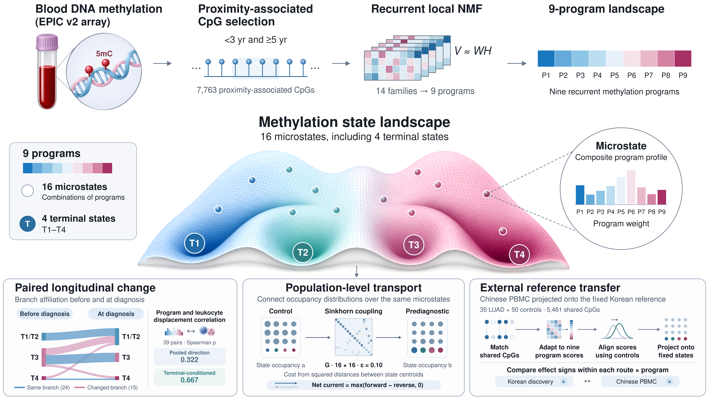

# Prediagnostic blood methylation landscape

Research code for *Blood methylation resolves heterogeneous hematopoietic remodeling before lung cancer diagnosis*.



This repository contains Python landscape analysis, cohort R scripts, plotting code
and utilities for extracting numerical Figure Source Data. **It does not contain
participant-level datasets**. Figure Source Data are intended for separate journal submission.

## Find the code

| Directory | What belongs here |
|---|---|
| [`pipeline/`](pipeline/) | One flat directory of descriptive Python workflow steps; **`run.py` defines their execution order** |
| [`src/pfl/`](src/pfl/) | Reusable functions for NMF, projection, Bayesian models and geometry |
| [`r/analysis/`](r/analysis/) | Cohort, epigenome and contextual R analyses |
| [`r/figures/`](r/figures/) | Component figures, grouped by scientific topic |
| [`r/source_data/`](r/source_data/) | Lightweight exports from authorized study R objects |
| [`tools/`](tools/) | Source Data assembly and analytical checks |
| [`config/`](config/) | Fixed model specifications |
| [`env/`](env/) | R 4.4.2 package inventory (author environment) |
| [`tests/`](tests/) | Synthetic unit tests and source-data contracts |
| [`data/`](data/) | Input requirements and non-personal aggregate fixture |

**Why are there no numbered script names?** The numbered prefixes in the original
analytical working directory represented run order, not figure numbers. The
public version uses function-based filenames, while `run.py list` displays
the explicit ordered workflow. Source-data file names keep figure numbers
only when they refer to a manuscript panel.

## Python setup and checks

Use Python 3.11 or a compatible version with `requirements.txt`:

```bash
python -m pip install -r requirements.txt
python -m unittest discover -s tests -v
python run.py list
python run.py check
```

The last command reports missing private inputs until authorized study files
are staged. This is normal in a public clone.

## Running the workflow on authorized data

The six required CSVs are listed in [`data/README.md`](data/README.md).
Copy them into **untracked** `rebuild/data/` only on an approved research
computer. Optionally retain an existing NMF discovery checkpoint under
`rebuild/cache/discovery/` to skip that expensive step.

```bash
python run.py run --execute --allow-clean
```

**Caution:** This clears/replaces generated outputs under `rebuild/`.
Back up local analysis outputs first. Use `--recompute-discovery` only
when intending to repeat the resource-intensive NMF discovery.
`pipeline/render_analysis_diagnostics.py` draws internal quality-control
figures, **not** the journal's assembled multi-panel artwork.

The R cohort/figure scripts require additional R packages and project-local
objects; see [`r/analysis/README.md`](r/analysis/README.md) and
[`r/figures/README.md`](r/figures/README.md). The R rendering workflow
has not been executed in the packaging environment.

## Figure Source Data

The journal workbook `Nature_Communications_Source_Data.xlsx` contains one
worksheet per main/supplementary figure. Full CpG-level tables and extended
numerical data files are supplied **separately**, not mixed into this code ZIP.
See [`tools/build_source_data.py`](tools/build_source_data.py) for recreating
figures' numerical exports from an authorized, completed analysis.

## Access, ethics, reuse

The underlying NCC, KCPS-II and NCC Biobank individual-level data, sample
identifiers, dates, methylation matrices and private RDS caches are not
distributed here. Reuse requires permission from the respective custodians.
The external public PBMC dataset is GEO GSE275371. Reference-model parameter
release and any code license require rights-holder approval. No license is
asserted by this repository snapshot.
